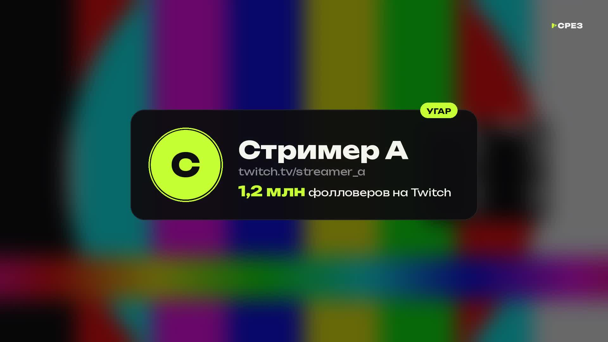

# Нарезчик СРЕЗ

Берёт несколько длинных стримов, находит в них самые сильные моменты и монтирует
из них один ролик на 30 или 60 минут. Перед каждым клипом идёт плашка: аватар,
имя стримера, ссылка на его Twitch и число фолловеров.



## Как он находит моменты

Нарезчик не смотрит весь стрим подряд, иначе на 6 часов эфира уходили бы часы. Он слушает два сигнала:

1. **Чат.** Когда на стриме что-то происходит, чат взрывается, и это самый надёжный признак.
   Считается, сколько сообщений приходит в секунду, и какие в них реакции:
   - `KEKW`, `ахахах`, `ору` — **угар**
   - `monkaS`, `страшно`, `😱` — **жуть**
   - `Pog`, `ого`, `имба` — **эпик**
   - `WTF`, `ЧТО???` — **шок**

   Чат реагирует на 5–10 секунд позже события, это учитывается.
2. **Звук.** Крики, смех, резкие скачки громкости. Громкость сравнивается с обычным уровнем этого же стримера, поэтому тихий и громкий стример оцениваются одинаково честно.

Из этого получается «сила» каждого момента. Дальше нарезчик:
- берёт пики и захватывает 15–20 секунд до них, чтобы было понятно, с чего всё началось;
- режет клипы по паузам в речи, а не на полуслове;
- набирает самые сильные моменты, пока не наберётся нужная длина ролика, и следит, чтобы один стример не занял весь выпуск;
- ставит самый сильный момент в начало, второй по силе в конец, остальные идут вперемешку между стримерами.

**Быстро.** Для ссылок на Twitch сначала скачиваются только звук и чат, это в 20–50 раз меньше видео.
Видео потом скачивается только кусками вокруг выбранных моментов. Анализ 6-часового файла с диска занимает около минуты.

## Реклама на экране стрима

Баннеры спонсоров, логотипы казино, QR-коды и промокоды закрываются при монтаже: по умолчанию размываются до нечитаемости (`mask_style = "fill"` закрашивает их фоном).

Как это работает:
1. Команда `prepare` скачивает куски видео и ищет статичные элементы с чёткими контурами: реклама висит на одном месте, пока игра и вебка меняются.
2. По каждому стримеру получается лист проверки `work/<проект>/layouts/<стрим>.jpg` с сеткой 10%. Лаймовым обведены кандидаты (S1, S2…), красным — уже заданные маски (M1, M2…).
3. Я смотрю листы, отделяю рекламу от интерфейса игры и рамки вебки и записываю маски в `work/<проект>/masks.json`:

```json
{"vod2895198615": [[0.70, 0.01, 0.28, 0.17], {"box": [0.0, 0.66, 0.16, 0.27], "from": "1:20:00", "to": "2:05:00"}]}
```

Координаты задаются долями кадра: `x, y, ширина, высота`. `from`/`to` нужны, если баннер висит только часть стрима.
Маски можно задать и прямо в проекте: `masks = [[0.70, 0.01, 0.28, 0.17]]` внутри `[[stream]]`.

Если закрыть надо большую часть кадра (например, чат зрителей поверх вебки на треть экрана), размытие смотрится плохо —
лучше кадрировать: `frame = [{box = [0.375, 0.12, 0.625, 0.625], to = "2:46:00"}]` у стрима. В ролик идёт только эта
часть кадра, как будто камера приблизилась (для картинки 16:9 ширина и высота в долях равны). Зум на реакцию
тогда мягче, чтобы картинка не мылилась.

## Мат

Для подростковой аудитории мат запикивается: `censor = "beep"` в разделе `[video]` проекта
(`"mute"` — просто заглушить, `"off"` — оставить как есть).

Речь каждого выбранного клипа распознаётся с точным временем слов (faster-whisper) три раза:
основной проход — модель `small` с фильтром тишины (его слова идут в подписи, зумы и вырезку пауз),
и два проверочных только для мата — `small` и `medium` без фильтра. Фильтр тишины выбрасывает целые фразы
тихой речи (голос из телефона, озвучка в игре), а каждая модель где-то пропускает короткий мат («блять» между словами),
поэтому пищит всё, что услышал хоть один проход. Корни мата ищутся по словарю в `srez/censor.py`,
на их месте звук глушится и звучит короткий писк 1 кГц.
Распознавание идёт 1–2 минуты на клип и кэшируется в `work/<проект>/censor/`, повторный монтаж его не повторяет.
В кэше хранятся слова, а где пищать, считается заново при каждой сборке: новые корни мата в `srez/censor.py`
сразу доходят и до уже распознанных клипов.

Мат, который распознаватель записал искажённо («съевался», «цыгнаху»), запикивается вручную в файле отбора:
`bleep = [["2:25:41.1", "2:25:42.1"]]` у клипа — время стрима. Где он, видно по полной расшифровке стрима.
Бывает, что слово распознано верно, но его время сдвинуто на полсекунды (в выпуске №4 так было со звуком
рабочего стола у Равшана) — тогда писк задевает только край слова. Поэтому готовый ролик проверяется ещё раз
моделью `medium`, а точное время проскочившего слова — тем же `medium` по исходнику клипа (по словам, beam 5).

## Стиль монтажа

Включён по умолчанию (`transition = "sting"`), всё настраивается в `[video]` проекта:

| Что | Как | Настройка |
|---|---|---|
| Хук | 3 самых сильных панчлайна по 1,8 с в самом начале под музыку | `hook = 3` (0 — без хука) |
| Переходы | 0,4 с: лаймовый косой «срез» со знаком канала и «вжух» | `sting_seconds = 0.4`; `transition = "plate"` — старая плашка 1,4 с |
| Плашка стримера | поверх первых 4 с клипа: название момента, аватар, ник, ссылка, фолловеры | `lower_third = 4.0`; у стрима `plate_side = "right"`, если слева внизу вебка |
| Зум на реакцию | резкий зум на лицо (детектор лиц YuNet) с затухающей тряской и «бум» | `zoom = true` |
| Подпись-реакция | 2–4 слова крупно, последнее на лайме; мат звёздочками | `captions = true` |
| Паузы | тишина без слов длиннее 0,8 с вырезается (звук и видео синхронно) | `jumpcut = 0.8` (0 — не вырезать) |
| Музыка | только под хук и концовку | `music = "funkorama"` (`""` — без музыки) |
| Дисклеймер | «Развлекательный контент. Возможна ненормативная лексика» поверх первых 4 с и в описании | `disclaimer = "…"` (`""` — без него) |

Звуковые эффекты синтезируются кодом (`srez/sfx.py`), поэтому на них не бывает претензий. Музыка — треки Kevin MacLeod
(incompetech.com, лицензия CC BY 4.0): монетизация разрешена, автор автоматически указывается в описании.

Превью — «постер» (`srez/poster.py`), как у больших нарезок: стример вырезан из кадра (`poster.cutout`) с белой обводкой
и тенью (`poster.place`), яркий фон с лучами (`poster.burst`), рядом предмет-«крючок» со свечением (шлем, приз, еда),
крупные 2–3 слова и ник с логотипом (`poster.finish`). Кадр — из исходника клипа, где лицо крупно и с эмоцией;
лишнее за спиной стирается `poster.erase`. Два варианта для теста — с разной идеей, например «эмоция + предмет»
и «до → после» (две вырезки, между ними лаймовый косой срез и стрелка `poster.arrow`).
Простой вариант без вырезки — `plates.thumbnail`: кадр, рамка 16:9, ник и 2–3 слова.

## Шортсы

Вертикальные ролики 1080×1920 на 15–30 с из уже собранных выпусков: берутся те же исходники, маски рекламы и писк мата.

```bash
python -m srez shorts projects/shorts-01.toml       # все шортсы из файла → output/shorts/
python -m srez shorts projects/shorts-01.toml 03    # только третий
```

Каждый шортс — блок `[[short]]`: заголовок, раскладка (`face` — кадр по лицу, `split` — вебка сверху и игра снизу,
`fit` — кадр целиком) и куски клипов с секундами. Паузы вырезаются короче, чем в выпуске; субтитры крупные, по словам,
текущее слово подсвечено лаймом, мат звёздочками. Все настройки описаны в начале `srez/shorts.py`.

## Проверка на подвисания

После сборки выпуска и каждого шортса видео проверяется на повторы кадров посреди движения (`media.judder`):
так выглядит дёрганое или «зависающее» видео. Если они есть, в журнале будет «⚠ подвисает» с секундами.
Причина почти всегда в частоте кадров: стримы идут в 60 к/с, ролик собирается в 30, и без выравнивания времени
кадров (`media.snap_tb`) часть кадров дублируется.

## Что получается на выходе

В папке `output/`:
- `<проект>.mp4` — готовый ролик 1920×1080 в стиле канала (см. ниже), в конце 12 секунд концовки под конечные элементы YouTube.
- `<проект>_описание.txt` — описание для YouTube: название, таймкоды (главы) по каждому клипу, ссылки на всех стримеров и оригинальные трансляции, автор музыки, хэштеги.

В папке `work/<проект>/`:
- `candidates.json` — все найденные моменты. Лишний момент можно выключить (`"keep": false`) или подписать (`"title": "..."`).
  Зум и подпись-реакцию можно задать вручную: `"zoom_at": 12.4` (секунда клипа; `-1` — без зума), `"caption": "НОГА!"` (`"-"` — без подписи),
  звуки: `"sfx": [["ding", 8.2]]` (есть `whoosh`, `boom`, `ding`, `boing`, `logo`).
  Удобнее всё это задавать в файле отбора `projects/<проект>.picks.toml` (формат — в начале `srez/editorial.py`). Там же:
  `zoom_box = [x, y, ширина]` долями кадра — куда зумить, если автоматика нашла не то лицо (чужое видео на экране,
  собеседник в Discord вместо стримера); `after = "id клипа"` — поставить клип сразу за другим (одна тема у разных
  стримеров: в выпуске №4 «медиабои» Бустер → Равшан → leva2k шли подряд).
- `review.md` — обзор для проверки: по каждому моменту 4 кадра и что писал чат.

## Как пользоваться

### Вариант 1: присылаете стримы мне (Claude)

Пришлите ссылки на записи стримов (Twitch VOD) или сами файлы и скажите длину ролика.
Я запущу анализ, просмотрю найденные моменты (кадры и чат), уберу слабые, подпишу клипы и смонтирую ролик.

Для работы по ссылкам облачной среде нужен доступ в интернет к Twitch, сейчас он закрыт.
Откройте настройки среды (меню среды в заголовке сессии → Edit) → **Network access** и выберите полный доступ (Full).
Можно вместо этого добавить в Allowed domains домены `twitch.tv`, `gql.twitch.tv`, `usher.ttvnw.net`, `static-cdn.jtvnw.net`, `cloudfront.net`.
Подробнее: https://code.claude.com/docs/en/cloud-environments#network-access

### Вариант 2: запускаете у себя на компьютере

1. Установите [Python 3.11+](https://www.python.org/downloads/) и [ffmpeg](https://ffmpeg.org/download.html).
2. В папке проекта выполните: `pip install -r requirements.txt`
3. Скопируйте `examples/project.toml`, впишите свои стримы.
4. Запустите:

```bash
python -m srez check                    # проверить, что всё установлено
python -m srez auto мой_выпуск.toml     # найти моменты и смонтировать
```

Можно и по шагам: `analyze` ищет моменты → вы правите `candidates.json` → `prepare` скачивает видео и находит рекламу → вы проверяете маски → `render` монтирует.
Повторный `render` пересобирает только то, что изменилось.

## Скорость

Замер на облачном сервере с 4 ядрами:

| Этап | Время |
|---|---|
| Анализ звука и чата | ~10 секунд на час стрима (файл с диска) |
| Монтаж в 1080p | ~0,3 минуты на минуту ролика: 30 минут ролика ≈ 9–10 минут |

На домашнем компьютере с 8+ ядрами монтаж идёт быстрее. Чтобы ускорить ещё сильнее, укажите `preset = "ultrafast"`, качество при этом станет немного ниже.

## Про число фолловеров

На Twitch есть **фолловеры** (бесплатная подписка, число публичное) и **сабы** (платная подписка, число скрыто).
Поэтому на плашке показываются фолловеры, данные берутся с Twitch в момент сборки.
Если Twitch недоступен, число можно вписать вручную: `followers = 1250000`.

## Ограничения

- Без чата нарезчик ищет только по звуку, и качество заметно ниже. Если чат скачать не удалось, его можно скачать программой [TwitchDownloader](https://github.com/lay295/TwitchDownloader) (Chat Download → JSON) и указать в проекте `chat = "..."`.
- Нарезчик понимает реакции, но не смысл шуток. Поэтому лучший результат даёт проверка `review.md` перед монтажом.
- Помните про авторские права: см. раздел в [README](../README.md).
